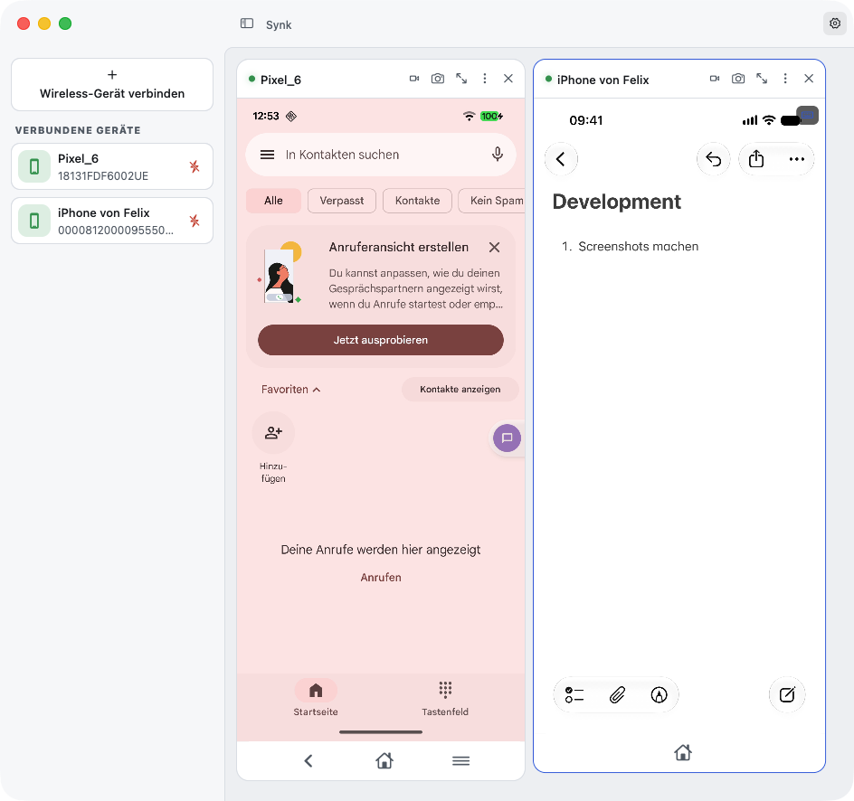
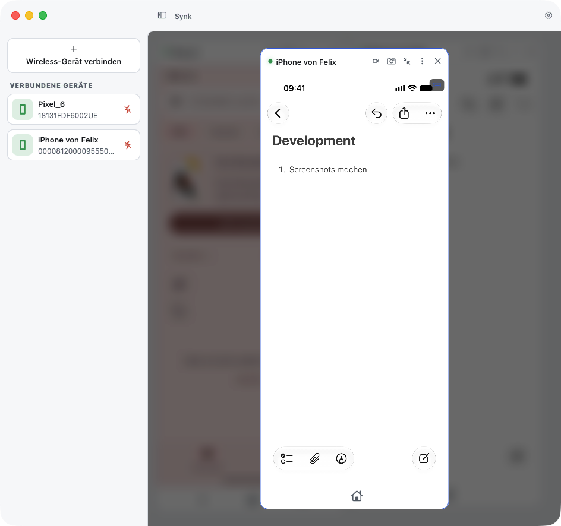

# synk

A **Vysor alternative** for macOS, written in Flutter. synk mirrors Android and iOS devices on your
desktop and lets you control them with mouse and keyboard.


<picture>
  <source media="(prefers-color-scheme: dark)" srcset="docs/screenshots/devices-dark.png">
  
</picture>

## Features

- **Screen mirroring** of several devices at once, laid out in a grid; any device can be maximized
- **Mouse and keyboard input** on the mirrored screen
- **Screenshots and screen recordings**, saved to a folder of your choice
- **Audio forwarding** from the device (muted on connect by default, toggle in the toolbar)
- **Clipboard**: <kbd>⌘C</kbd> on a mirrored device copies its clipboard to the Mac, <kbd>⌘V</kbd> sends
  the Mac's clipboard to the device (text only)
- **Android only**: wireless connection via Wi-Fi pairing, file transfer and APK install by drag & drop,
  Back / Home / Recent Apps buttons
- **Settings** for frame rate, video quality, capture location, theme (light / dark / system) and more

Maximize any device to focus on it; the rest of the grid stays connected in the background:

<picture>
  <source media="(prefers-color-scheme: dark)" srcset="docs/screenshots/focus-dark.png">
  
</picture>

## Android vs. iOS

The two platforms work very differently under the hood, so the feature set is not identical.

**Android** runs entirely over ADB. synk pushes two helpers onto the device: the unmodified
[scrcpy](https://github.com/Genymobile/scrcpy) server (v4.1) for video, audio, input and clipboard, and
a small device agent of its own for screenshots. Nothing is installed permanently.

**iOS** has no equivalent to ADB, so synk uses what macOS and Xcode provide:

- The device is detected over USB and mirrored as a capture device through `AVFoundation` /
  `CoreMediaIO` — the same mechanism QuickTime uses. This always requires a cable.
- Touch, keyboard, the Home gesture and the power button go through the HID channel of Xcode's private
  `CoreDevice` framework.
- Audio comes from a separate `CoreDevice` media stream next to the video capture.
- Screenshots (at native resolution) and the clipboard go through `xcrun devicectl`.

| Feature                  | Android                           | iOS                                       |
| ------------------------ | :-------------------------------: | :---------------------------------------: |
| Connection               | USB or Wi-Fi                      | USB only                                  |
| Screen mirroring         | ✅                                | ✅                                        |
| Touch / mouse input      | ✅                                | ✅ ¹                                      |
| Pinch-to-zoom (trackpad) | ❌                                | ✅ ¹                                      |
| Keyboard input           | ✅                                | ✅ ¹                                      |
| Navigation buttons       | Back, Home, Recent Apps           | Home (as a swipe gesture) ¹               |
| Power / standby button   | ✅                                | ✅ ¹                                      |
| Volume buttons           | ❌                                | ❌                                        |
| Screenshot               | ✅                                | ✅ ³                                      |
| Screen recording         | ✅ (optionally with audio)        | ✅ (video only)                           |
| Live audio               | ✅ ²                              | ✅ ¹                                      |
| Clipboard (⌘C / ⌘V)      | ✅                                | ✅ (needs `devicectl`)                    |
| File transfer            | ✅ (to `/sdcard/Download`)        | ❌                                        |
| App install              | ✅ (APK)                          | ❌                                        |
| Frame rate / quality     | ✅                                | ❌                                        |

¹ Requires Xcode on an Apple Silicon Mac (see [Requirements](#requirements)). Without it the device is
mirrored view-only and silent.
² Requires Android 11 or later (a scrcpy limitation).
³ At native resolution via `devicectl`; without Xcode synk saves the mirrored frame instead.

**Why no wireless iOS?** Device discovery and video both go through the USB capture interface, which
only exists while the cable is plugged in.

**Why no file transfer or app install on iOS?** `devicectl` can only write into an app's own container,
so there is no place a dropped file would be visible on the phone, and installing apps needs a signed and
provisioned IPA.

## Requirements

- macOS 14 or later
- **Android**: USB debugging enabled on the device. ADB is bundled with the app; a different `adb`
  binary can be configured in the settings.
- **iOS**: the device connected by USB and trusted on this Mac. Mirroring alone needs nothing else.
  Input, audio, clipboard and native-resolution screenshots additionally need:
  - Xcode installed (synk checks for `xcrun devicectl` on startup)
  - an **Apple Silicon** Mac — Apple's `CoreDevice` framework ships for arm64 only, so on Intel Macs
    iOS devices are view-only and silent
  - the device being known to Xcode, i.e. it shows up in `xcrun devicectl list devices`
- Nothing is installed on the iPhone or iPad.

## Installation

### Prebuilt app

1. Download the `synk-macos-v<version>.dmg` from the
   [Releases page](https://github.com/FelixCpp/synk/releases).
2. Open the DMG and drag **synk.app** into `/Applications`.
3. The app is **not signed or notarized**, so Gatekeeper blocks the first launch. Either right-click
   `synk.app` → **Open** and confirm, or run once:

   ```bash
   xattr -dr com.apple.quarantine /Applications/synk.app
   ```

### Build from source

Requires the Flutter SDK (`^3.47.5`) and Xcode.

```bash
git clone https://github.com/FelixCpp/synk.git
cd synk/packages/synk_app
flutter pub get
flutter run -d macos          # debug run
flutter build macos --release # output: build/macos/Build/Products/Release/synk.app
```

## Repository layout

| Package                         | Purpose                                                                 |
| ------------------------------- | ----------------------------------------------------------------------- |
| `packages/synk_app`             | The macOS app: Flutter UI plus the native Swift plugins in `macos/Runner` |
| `packages/synk_ui`              | Design system / widget library                                          |
| `packages/api_adb`              | Dart wrapper around the `adb` command-line tool                         |
| `packages/api_devicectl`        | Dart wrapper around Xcode's `devicectl`                                 |
| `packages/device_agent`         | Protobuf definition of the protocol between app and Android device agent |
| `packages/android_device_agent` | The Android device agent (Kotlin), shipped as `classes.dex` in the app  |
| `packages/app_logger`           | Logging shared across packages                                          |
| `packages/scripts`              | Scripts that generate the protobuf code and the device agent build      |

## Development

```bash
cd packages/synk_app
flutter pub get
flutter test
flutter analyze
```

Releases are built by the [`Release macOS App`](.github/workflows/release.yml) workflow. Trigger it
manually from the **Actions** tab with a version such as `1.2.3`: it runs the tests, bumps
`pubspec.yaml`, builds the app, packages a DMG, tags `v1.2.3` and publishes the GitHub release.

Internal design notes (in German) live in [`docs/`](docs): [`ROADMAP.md`](docs/ROADMAP.md) and
[`PLATFORM_ABSTRACTION.md`](docs/PLATFORM_ABSTRACTION.md).

## License

[MIT](LICENSE). The bundled `scrcpy-server.jar` is redistributed unmodified under the Apache License 2.0,
see [`THIRD_PARTY_NOTICES.md`](packages/synk_app/assets/bundled_files/THIRD_PARTY_NOTICES.md).
